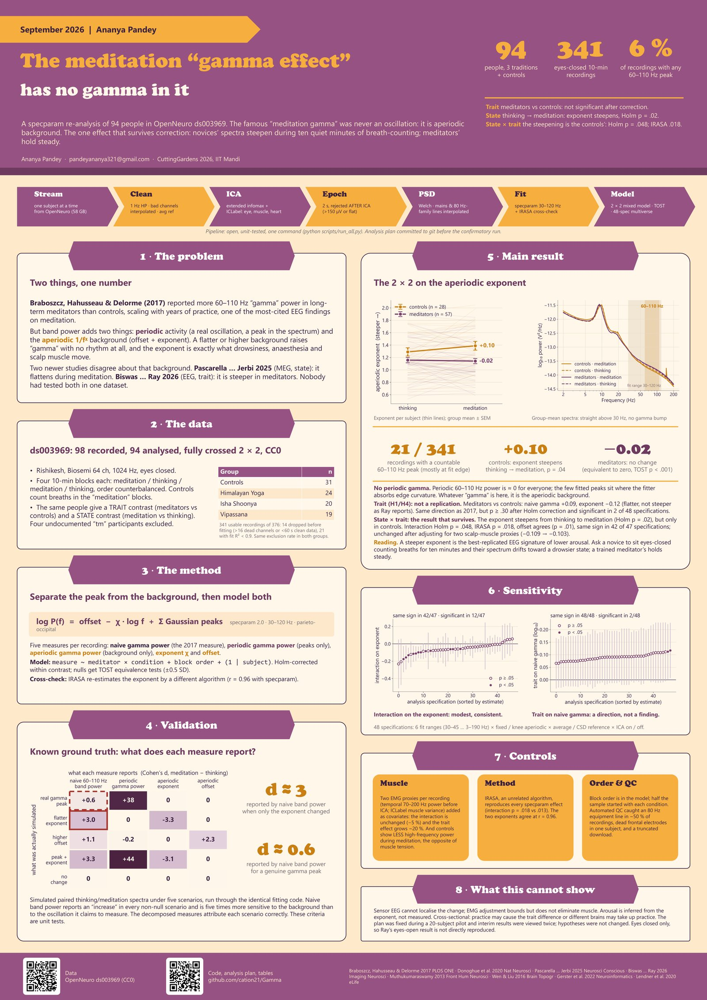

# Gamma: periodic and aperiodic gamma in meditation EEG

**Is the meditation gamma effect an oscillation or a broadband shift?**

This repository contains a re-analysis of OpenNeuro
[ds003969](https://openneuro.org/datasets/ds003969) (Braboszcz, Cahn, Levy, Fernandez &
Delorme 2017, *PLoS ONE*), a 64-channel EEG dataset in which practitioners of three meditation
traditions (Himalayan Yoga, Isha Shoonya, Vipassana) and controls alternated eyes-closed
meditation and mind-wandering ("thinking") blocks. Spectral parameterisation (specparam,
formerly FOOOF) is used to separate the periodic (oscillatory) and aperiodic (1/f background)
components of the reported 60–110 Hz gamma increase, and to test in a single dataset whether
the *state* (Jerbi lab, MEG) and *trait* (Ray lab, EEG) aperiodic findings conflict.

Presented as a poster at CuttingGardens 2026, IIT Mandi (Ananya Pandey).

- **Interactive walkthrough:** [`web/`](web/) is a React site explaining the method, the
  simulation and the results, deployable to Vercel (see [Web walkthrough](#web-walkthrough)).
- **Results:** [results/REPORT.md](results/REPORT.md), generated from the committed tables in
  [results/tables/](results/tables/).

## Poster

[](docs/poster.pdf)

Click the image for the full-resolution A0 PDF.

## Summary of findings

Sample: 94 participants analysed (63 meditators, 31 controls; four participants in the
undocumented `tm` group of the 98-subject dataset were excluded), 340 usable blocks in the
parieto-occipital ROI.

- Fits were good (specparam mean R² 0.97) and the specparam exponent agreed with IRASA (r = 0.96).
- A countable 60–110 Hz peak was present in **21 of 340 blocks** (6 %); a further 20 fitted
  peaks were pinned at a width limit and not counted.
- The state × trait interaction on the aperiodic exponent was β = −0.109 (95 % CI −0.195 to
  −0.023), p = .013 uncorrected; **p = .027 after Benjamini-Hochberg FDR** and **p = .052 after
  Holm** correction across the four fitted primary measures. It therefore holds under FDR
  control only. Controls' exponent was steeper during meditation than thinking; meditators'
  barely changed.
- Periodic gamma power was equivalent between groups within ±0.5 SD (TOST p = .041).
- Adjusting for scalp-muscle (EMG) proxies did not weaken the trait effect on the exponent.
- **Years of practice (meditators, exploratory, adjusted for tradition):** the meditation-vs-thinking
  effect does **not** depend on experience (years × state on the exponent p = .59; no measure
  significant). The resting *level* of gamma band power does: naive gamma power rises by 0.087 log10
  units per doubling of years (p = .002; FDR .005, Holm .009), and the increase is entirely
  aperiodic; periodic gamma power is unrelated to years (partial ρ = .10, p = .44). Practitioners with
  more than 10 years differed from controls (exponent −0.23, FDR p = .022; Holm .050), whereas those
  with 10 years or fewer did not (FDR p = .23). Results are in `results/tables/stats_practice.csv`.

The ground-truth simulation shows that the method attributes an effect to the correct component
(a pure slope change moved naive band power by d = +3.04 and periodic power by 0.00). It does not
establish sensitivity to small peaks: simulated effects are far larger than those in the real data.
The aperiodic exponent is treated as a candidate marker of cortical state, not a direct readout
of excitation/inhibition balance. These are preliminary results from a single dataset.

## Pipeline

```
00_simulate      ground-truth validation (no data needed)
01_download      fetch task BDFs from OpenNeuro (~600 MB / subject)
02_preprocess    filter, bad channels, average ref, ICA + ICLabel, epochs, EMG proxies
03_spectra       Welch PSD per preprocessing variant, IRASA on the primary ROI
04_parameterize  specparam fits per ROI -> long table; optional multiverse and per-channel fits
05_stats         mixed 2x2 (meditator x condition) with FDR/Holm correction, TOST,
                 dose-response and years-of-practice effects, EMG-confound, specification curve
06_figures       spectra, interaction plots, specification curves
07_stream        download -> process -> delete raw, per subject; replaces 01-03 with ~1 GB peak disk
08_report        write results/REPORT.md from whatever tables exist
```

All analysis decisions live in [configs/default.yaml](configs/default.yaml); the
specification-curve grid is in [configs/multiverse.yaml](configs/multiverse.yaml).

### Multiple comparisons

`medgamma.stats.adjust_pvalues` adds Benjamini-Hochberg (`p_fdr_bh`) and Holm (`p_holm`)
adjusted p-values to the mixed-model table. Each term (trait, state, interaction) is corrected
across the primary measures that were fitted. IRASA measures are cross-checks of the specparam
estimates and are not part of the correction family. The report shows uncorrected and both
adjusted p-values side by side.

## Setup

Requires Python ≥ 3.10.

```powershell
python -m venv .venv
.\.venv\Scripts\python -m pip install -e ".[dev]"
.\.venv\Scripts\python -m pytest
```

## Running the analysis

Full pipeline (resumable; add `--overwrite` for a clean rerun of all subjects):

```powershell
.\.venv\Scripts\python scripts\run_all.py
```

Stage by stage, using the streaming stage, which replaces 01–03 and needs about 1 GB of disk at
any time (each subject is downloaded, processed to ~4.5 MB of spectra, and its raw files deleted):

```powershell
.\.venv\Scripts\python scripts\00_simulate.py                       # validation, no data needed
.\.venv\Scripts\python scripts\07_stream.py --n-first 20 --n-jobs 4  # ~6 min per subject
.\.venv\Scripts\python scripts\04_parameterize.py --multiverse --channels
.\.venv\Scripts\python scripts\05_stats.py
.\.venv\Scripts\python scripts\06_figures.py
.\.venv\Scripts\python scripts\08_report.py
```

Omit `--n-first` to process all subjects (~10 h). Stages 01–03 remain available when you want to
keep the raw files and pre-ICA epochs on disk (`01_download.py`, `02_preprocess.py --n-jobs 8`,
`03_spectra.py --n-jobs 8`).

Every script accepts `--config`, `--subjects`, `--n-first N` and `--overwrite`.

**Google Colab:** [notebooks/colab_run.ipynb](notebooks/colab_run.ipynb) checkpoints outputs to
Google Drive so the run survives session limits; budget ~15 min per subject on the free tier.

## Data and storage

ds003969 is released under CC0 and is not committed here; `01_download.py` fetches it to
`dataset.bids_root` in `configs/default.yaml`. Raw data and derivatives go under the directory in
the `GAMMA_DATA` environment variable (default `~/GammaData`):

```powershell
setx GAMMA_DATA D:\GammaData        # Windows, persistent (open a new terminal afterwards)
```
```bash
export GAMMA_DATA=/data/gamma        # macOS / Linux
```

Keep this directory **outside any cloud-synced folder** (OneDrive, Dropbox): the raw data are
~58 GB and the derivatives ~30 GB, and sync clients that lock and re-upload each file as it is
written slow the pipeline by about two orders of magnitude.

## Web walkthrough

[`web/`](web/) is a Vite + React site with interactive spectra (the periodic/aperiodic model and
the simulated scenarios). To run it locally:

```bash
cd web
npm install
npm run dev
```

**Deploying to Vercel:** import the repository with the default settings. The root
[vercel.json](vercel.json) installs and builds `web/` and serves `web/dist`. No environment
variables are needed. (Alternatively, set **Root Directory** to `web` and let Vercel detect Vite.)

## Repository layout

```
medgamma/   package: config, data, preprocess, spectra, parameterize, simulate, stats, plots
scripts/    numbered pipeline stages
configs/    YAML analysis decisions
tests/      unit tests (run without data)
results/    tables/ (small CSVs, committed), REPORT.md; derivatives/ is ignored
figures/    generated figures (figures/poster/ at print resolution)
docs/       poster (PDF and JPG)
web/        interactive walkthrough (React, Vite)
```

## Citation and licence

Code is released under the [MIT License](LICENSE). If you use this pipeline, please cite the
dataset (Braboszcz et al. 2017; OpenNeuro ds003969) and specparam (Donoghue et al. 2020,
*Nature Neuroscience*).
